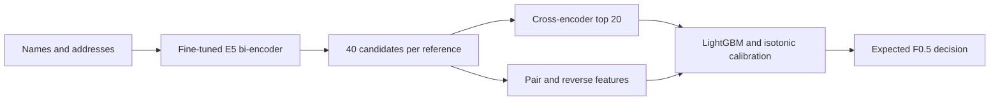
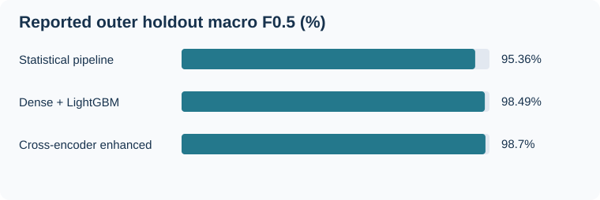

# Entity | Learning to match noisy business records

A research pipeline for large-scale multilingual entity resolution: contrastive bi-encoder fine-tuning, hard-negative cross-encoder training, and calibrated LightGBM set prediction. Developed for ML Challenge 2026.

## Reported experimental results

| Measurement | Result | Context |
| --- | ---: | --- |
| Public leaderboard macro F0.5 | **0.9829** | Project-reported challenge result |
| Outer holdout macro F0.5 | **0.987** | Cross-encoder enhanced matcher |
| Dense retrieval pair recall | **99.8%** | 40 candidates, held-out reference records |
| Statistical wide-pool recall | 99.5% | 434 candidates, inner-validation comparison |
| Contrastive training examples | 765,153 | 118M multilingual E5-small bi-encoder |
| Cross-encoder training pairs | 2,914,099 | Hard-negative training |

The retrieval comparison uses different evaluation populations; it is not a controlled same-split estimate. The candidate count fell from 434 to 40 (90.8% fewer). These numbers are transcribed from the [original technical report](TECHNICAL_REPORT.md), not newly reproduced. Raw challenge data, checkpoints and original run logs are not included in this checkout.

## Model architecture



- Contrastive training: one epoch, batch 256, learning rate 5e-5, 64 tokens per record; multiple-negatives ranking loss.
- Cross-encoder: one epoch, 2.91M pairs, 128 tokens, hard-negative mining; 61 minutes on two RTX 5070 GPUs as reported.
- Validation: disjoint neural-training reference records and component-grouped matcher folds; outer holdout reserved for final evaluation. This does not by itself prove that all target exposure or repeated holdout use is absent.
- Ablations and negative results: statistical blockers, rare-token features, dense-only retrieval, graph features and unused alternatives are preserved in the technical report.

## Reproduce

Python 3.12, Linux, compatible CUDA for neural stages, challenge dataset acquired separately. See [reproduction instructions](docs/REPRODUCIBILITY.md) and [original run guide](read_before_run.md).

```bash
python -m unittest discover -s tests -v
python -m venv .venv
source .venv/bin/activate
python -m pip install -r requirements.txt
python -m pip check
bash run_pipeline.sh --data-dir /absolute/path/to/dataset --work-dir "$PWD/work" --out-dir "$PWD/output"
```

The first command tests packaging and CLI wiring only; it does not train models or validate benchmark claims. Original dependency pins are preserved, not certified for a new machine.

## Evidence and limitations

- [Full methodology, ablation tables and reported results](TECHNICAL_REPORT.md)
- [Reproducibility and data availability](docs/REPRODUCIBILITY.md)
- [Provenance and individual contributions](docs/PORTFOLIO_PROVENANCE.md)

France is absent from the training data; cross-country generalization is not established independently. The full training run needs significant hardware and approved data. No new benchmark is claimed here. The repository does not contain a verified project-wide license; third-party model licenses do not grant rights to the challenge data or collaborators' code.

## Additional research verification



Historical project-reported comparison; see the technical report for evaluation context. [Training configuration and CPU demonstration](docs/TRAINING_AND_CPU_DEMO.md) and [individual contribution verification](docs/CONTRIBUTIONS.md) distinguish new reproducible checks from historical results. The CPU workflow publishes a real synthetic experiment artifact when run.
